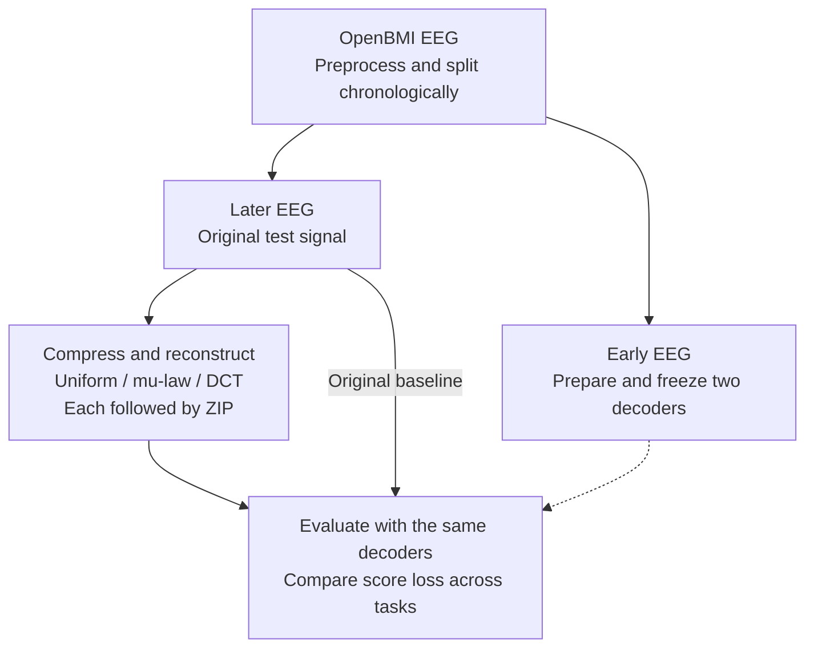

# Every Bit of the Brain

**How much EEG data can be lost?**

EEG records the brain's electrical activity. Compression makes these recordings smaller, but it can also remove information needed to interpret them. This project asks: **at the same storage allowance, which EEG tasks lose performance fastest, and how does the answer change with the compressor and decoder?**

[Explore the website](https://da3021-compression-lab-deb044.solidflask.chatgpt.site/) · [Presentation (PDF)](output/presentation/every-bit-of-the-brain.pdf) · [Editable PowerPoint](output/presentation/every-bit-of-the-brain.pptx)

The website introduces compression, explains EEG, reviews related research and presents the experiments with interactive plots.

## What was tested

The study uses first-day recordings from **20 evaluation participants** in the [OpenBMI dataset](https://doi.org/10.1093/gigascience/giz002).

| Task | What is detected? |
| --- | --- |
| SSVEP (steady-state visual evoked potential) | Which flickering target a person is looking at |
| Motor imagery | Whether a person imagines moving the left or right hand |
| P300 | Whether a flash is a target or a non-target |

Three methods are compared: **uniform quantization**, **mu-law quantization** and **discrete cosine transform (DCT) compression**, each followed by ZIP. All receive storage caps of **32, 64, 128 or 256 bytes/second/channel**, including reconstruction metadata. The original float32 signal needs 512 bytes/second/channel.

## Experimental pipeline

A decoder turns EEG into a task decision. Two decoders per task are prepared using the early part of each person's recording, then kept fixed while later EEG is tested before and after compression.



Recordings share 12 channels sampled at 128 Hz. The chronological split is at 60% of events, with a two-second guard on each side. Compression settings minimize waveform error within the byte cap, without using task labels. Saved compressed files are decoded before evaluation; a lossless ZIP control checks exact recovery.

Performance is measured by the drop in **balanced accuracy**, which gives each class equal weight. A fall from 80% to 70% is a loss of 10 percentage points. Results average participants equally and include participant-bootstrap uncertainty intervals.

## Main findings

- **The decoder changes the answer.** At the smallest budget, SSVEP loses the most on average with the primary decoders. With alternative decoders, P300 loses the most under uniform and mu-law compression.
- **DCT preserves the tested P300 features well.** At 32 bytes/second/channel, its mean primary-decoder loss is 0.61 points, versus 9.47 for uniform quantization. DCT's advantage repeats for all 20 people with both P300 decoders.
- **There is no reliable universal task ranking here.** The primary SSVEP-versus-motor-imagery difference remains uncertain, and results depend on the chosen methods.

This is an exploratory study of one dataset and one recording day. Both P300 decoders share the same features; state-of-the-art codecs were not tested. Preprocessing uses offline filtering, so this is not a real-time benchmark. Equal byte caps also allow different actual file sizes. See the [results audit](research/benchmark_audit.md) for the full findings and limitations.

## Run locally

To view the website, run this from the repository folder and open [localhost:8000](http://localhost:8000):

```sh
python -m http.server 8000
```

To rerun the study, use Python with the packages in [requirements.txt](requirements.txt). A CPU and 16 GB RAM are sufficient; no GPU is needed. Source downloads total about 20–25 GB, with extra space needed for processed data. The full run can take substantial time.

The [reproduction guide](research/experimental_methods.md#reproduce) contains all setup, download, evaluation and verification commands. Raw recordings and full compressed corpora stay in the ignored local cache; they are not included in this repository.

## Repository guide

- [benchmark/](benchmark/): preprocessing, compressors, decoders and evaluation code.
- [results/benchmark/](results/benchmark/) and [results/robustness/](results/robustness/): recorded results, predictions, plots and verification records. The earlier four-person pilot is kept in [results/pilot/](results/pilot/).
- [Experimental methods](research/experimental_methods.md), [protocol settings](benchmark/config.json) and [extension plan](benchmark/extension_protocol.md): detailed methods and reproducibility information.
- [presentation/](presentation/README.md): slide sources, notes and rebuilding instructions. The linked PDF and PowerPoint above are the latest edition.

AI assistance was used for research, writing and implementation. Reported measurements come from recorded runs and independent verification, not generated examples.
